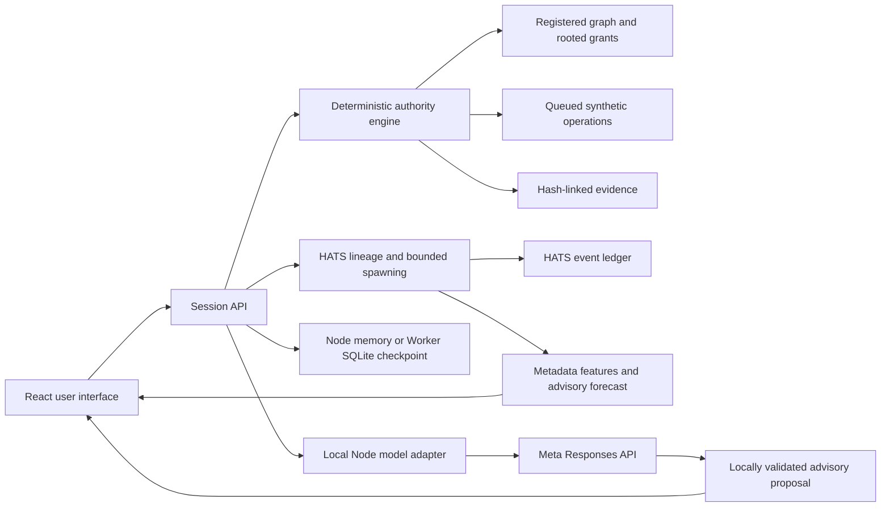

# Architecture and trust boundaries

## Independent lanes

The authority engine has no model dependency. Only explicit registered grants and current ancestor state can authorize its synthetic action. Parent scope cannot widen through delegation. Missing parents, cycles, and integrity failures deny execution. A previously authorized queue item must pass a new current-state check before it changes the synthetic action counter.

The local Node model lane receives a detached snapshot, labels that data untrusted, and returns a strict structured proposal. Only grant IDs already in the registered snapshot are accepted. No endpoint converts model text into a grant, revocation, or protected action. The API labels proposals `CONJECTURE`, `authority: none`, and records the analyzed run and revision in the response. A subsequent state transition can make an earlier proposal stale. The public Worker does not import the model adapter and always rejects model analysis with `PUBLIC_MODEL_DISABLED`.

HATS metadata analytics form another advisory lane. Recorded spawn timestamps, intervals and registered topology produce explicit features and an uncalibrated forecast. The authority engine does not accept that forecast as an authorization argument. It independently checks current ancestry, scope and bounded resource policy before each transition. A low forecast cannot bypass a quota; an unavailable forecast cannot grant permission. These features do not establish a human baseline, a calibrated AI likelihood, a real swarm or a consensus protocol.

## HATS identity and bounded generation

The HATS lab has a separate run, reset and export from the revocation graph. It starts with one synthetic Macro agent. Spawning follows Macro → Meso → Micro → Nano, with maximum depth 3, three children per parent, twelve agents in one run and six successful spawns in a rolling 60-second window. These are deterministic demonstration limits, not a predictor of arbitrary recursive programs. The lab creates data records; it does not launch external processes or autonomous cloud agents.

A lineage digest binds the schema version, run, unique agent ID, type, parent ID and parent digest, nonce, depth, specialization, inherited state digest and capability scope. Root identity is specific to the run and agent; unrelated roots do not share one fixed genesis identity. The verifier walks the full ancestry, recomputes each digest, validates references and depth, and rejects cycles. Missing evidence preserves `UNKNOWN`; malformed or inconsistent evidence fails verification. Neither state authorizes an action.

Capability inheritance is enforced as a subset at spawn time. A child cannot add an unsupported capability. Current active ancestry is checked again before a descendant invokes `invoke:synthetic`, including after a parent revocation. That action increments a local demonstration counter only. A receipt records a permitted transition; a SHA-256 receipt is an unkeyed digest, not a signature or independently trusted attestation.

Engine-owned metadata seals the current state against accidental or out-of-band mutation. Trusted server checkpoints contain bounded JSON, a version and consistency checks, and restore into engine-owned objects. No HTTP route accepts a browser-supplied checkpoint. Server operators can still rewrite an entire database; checkpoint checksums do not establish independent origin trust.

The one-click HATS demo exercises a four-level hierarchy, an authorized action, denied depth/scope/quota attempts, ancestor revocation and a denied stale descendant invocation. Verification checks the actual resulting records and ledger. The demo's expected outcomes do not substitute for recomputation.

## Registered graph verification

Revoking the primary grant invalidates all descendants. Traversal finds active operator-to-action paths in the sealed registration, including an intentionally independent service-account route in the alternate scenario. The witness path explains a failure without pretending that one revoked grant covers every other root.

PASS requires all of the following: primary grant validly revoked, no registered active route to the action, a queued attempt actually denied after revocation, internally consistent evidence, and scenario-declared inventory completeness. A known failure takes precedence; otherwise an unknown required condition preserves UNKNOWN. Even PASS is limited to registered synthetic routes in this run.

The completeness flag is a scenario declaration, not independent discovery of every real system or credential. The demo does not implement credential rotation, distributed revocation propagation, expiring capability tokens, real tool adapters, or third-party identity attestation.

## Ledger

Each event records sequence, run reference, time, type, evidence class, data, previous digest, and a SHA-256 digest of canonical JSON with lexicographically sorted object keys. Verification recomputes digests and validates contiguous sequence, unique IDs, run references, and chain links. The engine retains a tip and sealed registration outside the public snapshot. Node retains them in process memory; the Worker preserves them in a server-side SQLite checkpoint and restores them into engine-owned state on each operation.

The exported bundle contains the final snapshot, event chain, verification result, scope, and explicit trust limitations. A party with write access to an entire unanchored export can rewrite and rehash it. The standalone verifier can report internal consistency, but cannot recover external origin trust or vouch for the reported runtime result.

## Local Node service

Native Node HTTP serves the React build and a small JSON API. Per-session in-memory sandboxes prevent browsers from changing each other's demo runs. JSON bodies are bounded, cross-origin mutations are rejected, provider errors are sanitized, credentials remain server-side, and model calls have a timeout and local rate limit.

HATS checkpoints and their event rows use Node's in-memory SQLite database. The event table is an inspectable storage projection of the engine ledger; its presence does not make the ledger immutable. A Node restart discards the database and its sessions.

Bind the Node service to loopback by default. Its cookie is not an identity assertion or authentication mechanism. Authenticated ingress and shared quotas are required before exposing its paid model endpoint publicly. Trusted signing keys, operational policy and real protected-system adapters are outside this demonstration.

## Public Worker and persistence

`worker/index.mjs` serves an explicit allowlist of built interface assets and the deterministic API. A random 192-bit session cookie selects a `GuardianSession` Durable Object. The HTTPS cookie uses `HttpOnly`, `Secure` and `SameSite=Strict`; possession isolates one anonymous demo session and does not establish a person's identity. JSON requests are bounded to 16 KiB, and declared cross-origin mutations are rejected.

Each Durable Object stores a single checkpoint row in SQLite. Reads, restoration, engine operations and checkpoint writes run synchronously in one transaction. No model call or external action runs inside that transaction. The checkpoint preserves the registration, revoked grants, queue receipts, idempotency flags, evidence chain and result. It is internal server state, never an accepted browser upload or an evidence export.

The HATS lab adds separate `hats_state` and `hats_events` tables to that session's SQLite database. It does not replace the existing revocation checkpoint. The HATS checkpoint and event projection are persisted within the same session transaction, so a failed operation is not partially committed. Keeping the labs separate lets an existing queued revocation run survive an application upgrade that adds HATS.

Restoration checks the checkpoint version, shape, size, checksum, registered topology and retained-state consistency before recreating engine-owned metadata. A corrupted checkpoint fails closed. The checksum detects corruption relative to retained data; it is unkeyed and does not protect against a privileged server operator who replaces the entire checkpoint.

Worker runtime restart does not discard a valid SQLite checkpoint. Each successful operation extends the one-hour idle deadline; an alarm removes an expired row, and an expired session starts a fresh run. Reset replaces the run. A run can contain at most 200 events; an operation that would cross the limit is rejected without persisting its changes. State and evidence remain readable so the participant can export and reset.

The Worker has no model-secret binding or Meta transport and always returns HTTP 503 for `/api/analyze`. Paid model access would require a separately authenticated service with shared rate limiting. Public traffic can still consume Worker and Durable Object resources; the event bound is not an account-wide abuse or billing limit. See [DEPLOYMENT.md](DEPLOYMENT.md).

## API

| Method | Path | Purpose |
| --- | --- | --- |
| GET | `/api/health` | Runtime mode and Meta availability; no secret value |
| GET | `/api/state` | Detached session snapshot |
| POST | `/api/reset` | New `queued`, `alternate`, or `unknown` sandbox |
| POST | `/api/baseline` | Authorized synthetic operation and queued work |
| POST | `/api/revoke` | Revoke the primary grant |
| POST | `/api/replay` | Recheck and attempt pending queued work |
| POST | `/api/verify` | Compute bounded deterministic results |
| GET | `/api/evidence` | Download evidence JSON |
| POST | `/api/analyze` | Local Node: non-authoritative Meta proposal; public Worker: always disabled |
| GET | `/api/hats` | Detached HATS snapshot and advisory analytic features |
| POST | `/api/hats/reset` | Replace the HATS lab with a fresh root |
| POST | `/api/hats/spawn` | Attempt a child with bounded type and inherited scope |
| POST | `/api/hats/revoke` | Revoke a registered agent's authority |
| POST | `/api/hats/adjudicate` | Recheck current ancestry before a synthetic invocation |
| POST | `/api/hats/verify` | Recompute lineage, ledger and retained-state checks |
| POST | `/api/hats/demo` | Exercise the bounded demonstration in a fresh lab |
| GET | `/api/hats/evidence` | Download the separate HATS evidence bundle |

See [TELEMETRY.md](TELEMETRY.md) for metadata minimization and the proposed operator-controlled cluster boundary. No eBPF probes, memory scans or live network collectors are deployed by this application.
